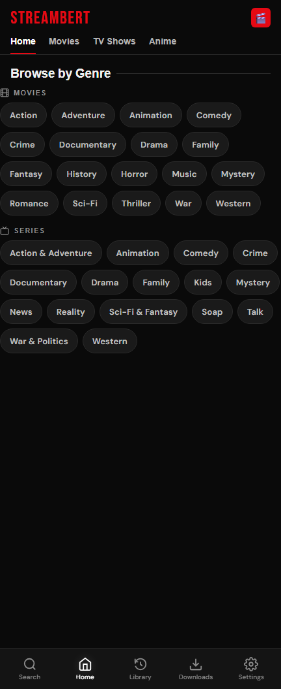
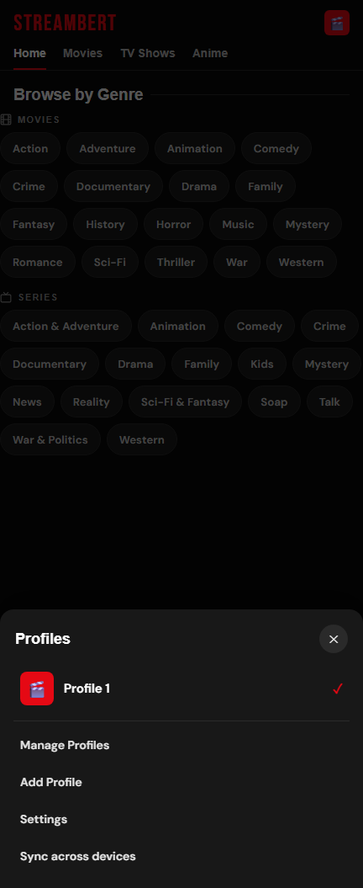
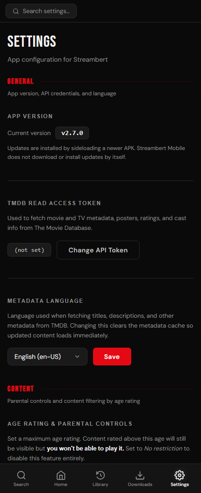

# Streambert Mobile (Android)

Android port of the Streambert desktop app. Built as an installable APK
(version `1.0.4`, versionCode 25) that reuses the Streambert React
renderer inside a native Android WebView, with a native full-screen player and
a native HLS download service.

The WebView loads `https://streambert.local/index.html`; Electron-only IPC is
emulated by `assets/www/mobile-shim.js`, which routes calls to the
`window.Android` JavaScript bridge exposed by `MainActivity`.

---

## Screenshots

Captured from the renderer running in a phone-sized viewport (the same UI the
Android WebView displays).

### Home — browse by genre



The home page keeps the hero banner, trending and continue-watching rows, and
adds a **Browse by Genre** section: six poster carousels (Action, Comedy,
Sci-Fi for movies and series) built from the same row component as Trending,
with a compact genre-chip strip below for the full genre browser. The bottom
bar gives quick access to Search, Home, Library, Downloads and Settings.

### Profiles — who's watching



Netflix-style profiles: a "Who's watching?" picker once two or more profiles
exist, up to five emoji or uploaded-photo avatars, and separate My List /
Continue Watching / history / watched / search history for each profile.
Profiles (with photos) and per-profile watch data can be merged across devices
through a private GitHub Gist.

### Settings



The full settings surface on mobile: app version and TMDB token, metadata
language, age rating and parental controls with an optional 4-digit PIN,
playback (trailer source, autoplay, anime intro skip, subtitles), downloads,
notifications, interface (home layout, start page, appearance), library sort
order, and backup/restore and storage. The bottom bar highlights the active
Settings tab.

---

## 1. Original Streambert features (ported to Android)

Core browsing & playback
- Home page with hero banner, trending, top rated, recommended and continue-watching rows
- Home tabs for Movies, TV Shows and Anime (TMDB lists, same age filtering)
- Netflix-style profiles: a "Who's watching?" picker once two or more profiles
  exist, up to five emoji or uploaded-photo avatars, and separate My List /
  Continue Watching / history / watched / search history for each profile
- Optional cross-device sync: profiles (with photos) and per-profile watch data
  are merged through a private GitHub Gist keyed by the TMDB token; a GitHub
  token with Gist read/write access is entered once per device
- Netflix-style phone UI: charcoal theme, Top 10 row, horizontal poster rows,
  swipeable home tabs and a full-bleed detail page
- Movie and TV detail pages (cast, score, runtime, overview)
- Search across movies and series
- Library: watchlist, history, continue watching
- Streaming from multiple providers (Videasy, Vidking, VidSrc, etc.) with in-app source switching
- Full-screen native player (tap to reveal controls, auto-hide after 3.5 s)
- Ad blocking in the player WebView
- Watched threshold / auto-mark watched
- Autoplay next episode with countdown and overlay position
- Anime intro skip via AniSkip (HiAnime source)
- Trailer playback via Invidious (privacy-friendly YouTube frontend, with fallback instances)

Metadata & parental controls
- TMDB metadata, posters, cast, ratings and age certification
- Configurable TMDB read-access token and metadata language
- Age rating & parental controls: hide/play-block titles above the configured limit
- Rating country selection (maps certificates like PG/FSK/BBFC to a minimum age)
- Optional 4-digit parental PIN: protects the age-rating Save button; change or
  remove it with the PIN, and recover a forgotten PIN with a one-time recovery
  code (view or replace it from the recovery screen)

Subtitles
- Subtitle language preference
- Subtitle settings (SubDL / Wyzie API keys where supported)

Settings & appearance
- Theme presets + custom colour editor
- Accent colour (with player pass-through)
- Compact card grid, reduce animations
- Start page selection (Home / Library / Downloads)
- Home page row layout and visibility
- Library sort order and watch-history privacy
- Clear cache, clear watch progress, delete all downloads, full app reset

Downloads
- Downloaded files appear in the in-app Downloads page
- Open, delete and "delete all" downloads
- Download size accounting
- **Download Season** — queues every episode of the selected season; the app
  resolves each stream in turn and the downloads run one at a time in the
  background, with per-episode progress in the notification
- **Genre carousels on the home page** — instead of a block of genre chips that
  opened a separate page, the home page now shows six poster carousels
  (Action / Comedy / Sci-Fi for movies and series) using the same component as
  Trending; a compact chip strip below still opens the full genre browser

Automatic updates
- **Built-in APK updater** — the app checks the latest release on launch, shows
  the new version and its changelog, downloads the APK, verifies that it is the
  same package, is newer and is signed with the same key, then hands it to
  Android's installer. No more hunting for a newer APK by hand.
- **Update controls in Settings** — an "Automatic checks" toggle and a
  "Check for updates" button in the App Version section, plus the state of a
  downloaded update (with an Install button if you tapped "Later").
- Checks are throttled to once per 12 hours and failures stay silent unless you
  check manually. The release source is `UpdateManager.RELEASE_URL` (see
  "Publishing an update" below).
- Downloads are verified cryptographically before anything is installed: the
  APK must match the SHA-256 digest the release publishes (GitHub records one
  for every uploaded asset), and the URL must be HTTPS. A file that does not
  match is deleted instead of being offered to the installer, and a release
  with no digest is refused rather than trusted.
- The signer must also match the installed app, and that check now fails closed
  if either key cannot be read.
- Stored secrets are encrypted at rest with a non-exportable Android Keystore
  key (AES-256-GCM): the TMDB token and the GitHub sync token. The parental PIN
  and its recovery code are never stored at all, only salted PBKDF2 records.
  Values written by older builds are migrated on first use.

Performance on low-end devices
- **Immutable asset caching** — hashed bundles under `assets/www/assets` are
  served with a one-year cache, so relaunching no longer re-reads and re-parses
  all of the JavaScript. Hand-written files still revalidate each build.
- **No debug WebView in release** — `setWebContentsDebuggingEnabled` is tied to
  the debuggable flag instead of being forced on, which stops the inspector
  agent from costing memory and CPU on every launch.
- **Memory-pressure handling** — the WebView cache is released when Android
  reports low memory instead of letting the renderer get killed and reload.
- **Cheap rendering profile** — devices Android reports as low-RAM (or with
  under 3 GB) drop the backdrop blurs on bars and overlays, plus shadows and
  transitions, before the first paint. Layout and colours are unchanged.

---

## 2. Features added from user suggestions

- **Genre browser** — browse movies/series by genre, with a dedicated Genre page.
- **Surprise Me** button — jump to a random title.
- **Search genre filter** — filter search results by genre.
- **Next episode button** — quick jump to the next episode from the player/episode list.
- **Mobile-friendly Settings** — desktop-only options removed/converted (see below).

---

## 3. Features not adapted / not working on Android

Desktop-only features that have no Android equivalent (removed from the
mobile Settings page):
- Desktop update checker / update source toggle and "check on startup" — the
  mobile build has its own native APK updater (see "Automatic updates" above)
- Discord Rich Presence
- Scheduled backups (desktop file-system folder)
- Install location / "open install folder"
- Font-size zoom (`setZoomFactor`)
- Controller / gamepad support
- Download folder picker (fixed to `Download/Streambert`, managed by Android/MediaStore)
- Desktop notification toggles (converted to Android notifications; the
  "notify on download complete" toggle is removed because Android always posts one)

Features that are limited or unavailable on Android:
- Subtitle search/download (SubDL/Wyzie flows are disabled in this build; only the manual settings remain)
- HiAnime resolver (desktop scraper; unavailable on mobile)
- PiP window mode
- Drag-and-drop / file-system scanning of a local folder
- Scheduled backup export to a chosen folder
- Some hosters that require a desktop browser environment

Known limitations:
- HLS downloads are saved as fragmented MP4 (`.mp4`) or MPEG-TS (`.m2ts`); very old players may not handle them.
- HEVC-only streams depend on device decoder support for in-app playback.

---

## Build (Android Studio)

Requirements:
- Portable JDK 21
- Android SDK build-tools 35 + platform android-35
- Node (for the Vite renderer build)

Steps:
1. Edit the renderer in `streambert-mobile-build/` (or sync from `streambert-desktop/src`).
2. Build the renderer:
   ```sh
   node streambert-desktop/node_modules/vite/bin/vite.js build --outDir dist
   ```
   (run from `streambert-mobile-build/`)
3. Copy `dist/assets` into `streambert-android/assets/www/assets` and update
   `assets/www/index.html` hashes.
4. Bump `versionCode`/`versionName` in `AndroidManifest.xml` if needed.
5. Build the APK:
   ```sh
   powershell -ExecutionPolicy Bypass -File .\build.ps1
   ```
   (run from `streambert-android/`)
6. Install:
   ```sh
   adb install -r Streambert-Mobile.apk
   ```

The resulting APK is signed with the debug key and is ~0.5 MB.

## Publishing an update

The in-app updater reads `UpdateManager.RELEASE_URL`, which defaults to the
latest GitHub release of this repository. For an update to be offered:

- the release tag is the version name (`2.10.0-mobile` or `v2.10.0-mobile`),
- the release has one `.apk` asset (the built `Streambert-Mobile.apk`),
- the release body holds the changelog shown in the update dialog,
- `versionCode` in `AndroidManifest.xml` is higher than the installed build
  (the APK's own `versionCode` is verified before installing).

A plain JSON manifest works too if the APK is hosted somewhere else:

```json
{
  "versionName": "2.10.0-mobile",
  "versionCode": 21,
  "apkUrl": "https://example.com/Streambert-Mobile.apk",
  "notes": "What changed in this build",
  "pageUrl": "https://example.com/releases"
}
```

Published APKs must be signed with the same key as the installed build —
Android refuses an update signed with a different key and the updater reports
that instead of starting a doomed install.

## Device tested
- Samsung Galaxy A25 (SM-A256E), Android 16
- WebView debugging enabled; CDP available on `localabstract:webview_devtools_remote_<pid>`
- Downloads land in `Download/Streambert/` and are indexed in MediaStore

## Version history
- `1.0.4` (25) — secrets at rest: AES-256-GCM encryption of the TMDB and GitHub tokens with an Android Keystore key, parental PIN and recovery code stored as salted PBKDF2 hashes, transparent migration of old plaintext values
- `1.0.3` (24) — cryptographic update integrity: SHA-256 digest verification of every download, HTTPS-only release URLs, fail-closed signing-key checks
- `1.0.2` (23) — first build under the `1.0.x` numbering used by the GitHub releases; contains the built-in updater and the low-end performance work
- `2.11.0-mobile` (22) — smoother on low-end devices: immutable asset caching, cheap rendering profile, memory-pressure handling
- `2.10.0-mobile` (21) — built-in automatic APK updater (check, download, verify, install)
- `2.9.1-mobile` (20) — custom profile photos, uploaded from the device and synced
- `2.9.0-mobile` (19) — optional cross-device sync through a private GitHub Gist
- `2.8.0-mobile` (18) — Netflix-style profiles with per-profile watch data
- `2.7.9-mobile` (17) — Netflix-style theme, Top 10 row, swipeable home tabs
- `2.7.8-mobile` (16) — Home / Movies / TV Shows / Anime tabs on the home page
- `2.7.7-mobile` (15) — parental PIN for the age rating, with recovery code
- `2.7.6-mobile` (14) — home page genre carousels; chip block moved to a compact strip
- `2.7.5-mobile` (13) — "Download Season" button; queued, sequential downloads
- `2.7.4-mobile` (12) — in-app player for downloads; prefer H.264 variants
- `2.7.3-mobile` (11) — mobile Settings cleanup
- `2.7.2-mobile` (10) — unrated titles treated as 18
- `2.7.1-mobile` (9) — age-limit filtering across pages
- `2.7.0-mobile` — initial Android port
